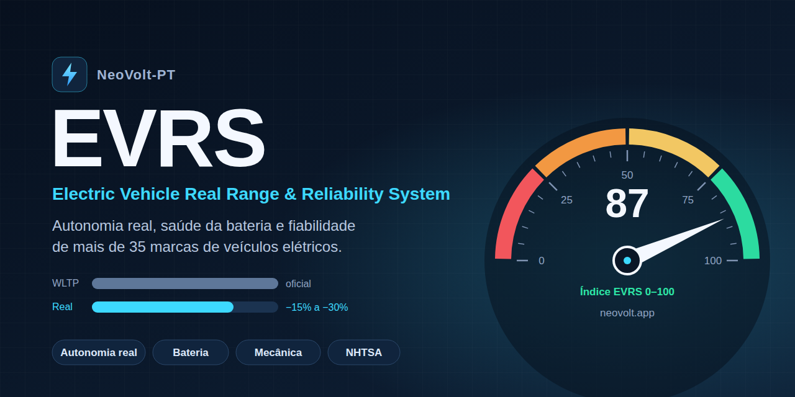
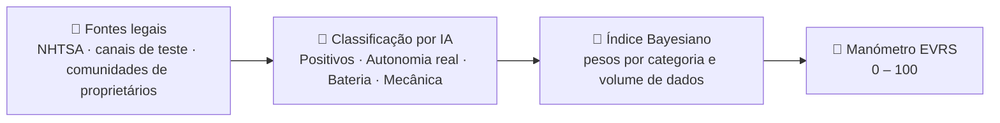

<div align="center">



<br />

**Quanto anda realmente um elétrico? E quão fiável é?**
Telemetria aberta e independente, com dados reais, para quem vai comprar ou já conduz um veículo elétrico.

<br />

[](https://www.neovolt.app/)
[](https://nextjs.org)
[](#-como-funciona)
[](https://www.neovolt.app/)

[**Abrir a app →**](https://www.neovolt.app/) · [Sobre o projeto](https://www.neovolt.app/about) · [Comparar (VS)](https://www.neovolt.app/compare) · [Apoios e incentivos](https://www.neovolt.app/results?brand=Incentives)

</div>

---

## 🔋 O que é o EVRS

O **EVRS** (*Electric Vehicle Real Range & Reliability System*) junta, num só sítio, o que os condutores de elétricos realmente vivem: **autonomia real**, **saúde da bateria** e **problemas mecânicos**.

Os valores oficiais (WLTP / EPA) são medidos em laboratório, a temperaturas amenas. Na estrada, a 120 km/h, no inverno ou com o ar condicionado ligado, a autonomia real pode ficar **15% a 30%** abaixo do anunciado. O EVRS agrega testes de estrada, queixas oficiais de segurança e relatos de proprietários para mostrar a diferença.

> Cobre **35+ marcas**, entre elas Tesla, BYD, Hyundai, Volkswagen, Rivian e BMW.

---

## ✨ Funcionalidades

| | Funcionalidade | O que faz |
|---|---|---|
| 🔎 | **Pesquisa por marca e modelo** | Encontra rapidamente dados reais de autonomia, fiabilidade e problemas de cada veículo. |
| 🏁 | **Índice EVRS 0–100** | Um manómetro de corrida que resume a fiabilidade de cada modelo numa só pontuação. |
| ⚔️ | **Comparador VS** | Coloca dois veículos lado a lado e compara autonomia, bateria e mecânica. |
| 🛣️ | **Autonomia real vs. WLTP/EPA** | Valores reais extraídos em km ou milhas, com conversão de unidades (**KM**) na interface. |
| 🪫 | **Saúde da bateria** | Alertas de degradação e de estabilidade em carregamento rápido DC. |
| 🛡️ | **Queixas de segurança (NHTSA)** | Registos públicos e oficiais integrados na análise. |
| 🏛️ | **Apoios e incentivos** | Descontos e medidas políticas para a compra de elétricos, organizados por país. |
| 🌍 | **Bilingue** | Interface em **Português** e **Inglês**. |
| 🔄 | **Atualização diária** | Pipeline automático que recolhe e classifica novos relatos todos os dias. |

---

## ⚙️ Como funciona



**1. Agregação multi-fonte.** Um pipeline diário analisa queixas oficiais de segurança (NHTSA), canais oficiais de testes de VE e comunidades globais de proprietários.

**2. Categorização por IA.** Cada relatório é classificado em *Positivos*, *Autonomia real*, *Bateria* ou *Mecânica*, e os valores reais de autonomia (km/milhas) são extraídos do texto.

**3. Índice Bayesiano 0–100.** A pontuação pondera o volume de dados e a gravidade de cada categoria: penaliza falhas críticas de bateria e de mecânica, e premeia autonomia e fiabilidade comprovadas.

### Pesos por categoria

| Categoria | Peso |
|---|:---:|
| 😀 Relato positivo | `+1.0` |
| 🛣️ Teste de autonomia real | `+0.85` |
| 🔧 Falha mecânica | `0.0` |
| 🪫 Alerta crítico de bateria | `−0.15` |

---

## 🧱 Stack

| Camada | Tecnologia |
|---|---|
| Frontend / App | [Next.js](https://nextjs.org) + TypeScript |
| Estilos | PostCSS / Tailwind |
| Recolha de dados | Scrapers em [`/scrapers`](./scrapers) |
| Base de dados | Esquema SQL em [`schema.sql`](./schema.sql) |
| Automação | GitHub Actions em [`.github/workflows`](./.github/workflows) |

### Estrutura do repositório

```
evrs/
├── .github/workflows/   # Automação (atualização diária dos dados)
├── public/              # Recursos estáticos
├── scrapers/            # Recolha de dados de fontes públicas
├── src/                 # Aplicação Next.js
├── schema.sql           # Esquema da base de dados
└── DEPLOYMENT_GUIDE.md  # Guia de publicação
```

---

## 🚀 Começar

```bash
# 1. Clonar o repositório
git clone https://github.com/NeoVolt-PT/evrs.git
cd evrs

# 2. Instalar dependências
npm install

# 3. Arrancar em modo de desenvolvimento
npm run dev
```

Abre [http://localhost:3000](http://localhost:3000) no browser.

Para configurar a base de dados e publicar a app, consulta o [**Guia de Publicação**](./DEPLOYMENT_GUIDE.md).

---

## 🤝 Contribuir

Sugestões, correções e novas fontes de dados são bem-vindas.

1. Faz *fork* do repositório
2. Cria um ramo: `git checkout -b feature/a-minha-ideia`
3. Faz *commit* das alterações: `git commit -m "Adiciona a minha ideia"`
4. Envia o ramo: `git push origin feature/a-minha-ideia`
5. Abre um *Pull Request*

Encontraste um erro nos dados de um modelo? Abre uma [*issue*](https://github.com/NeoVolt-PT/evrs/issues) ou usa a página de [contacto](https://www.neovolt.app/contact).

---

## 👤 Criador

<table>
  <tr>
    <td align="center" width="140">
      <a href="https://github.com/filmfer">
        
      </a>
    </td>
    <td>
      <h3>Filipe Fernandes</h3>
      <p>Fundador e criador do EVRS, através da <b>NeoVolt-PT</b>.<br/>
      Um projeto independente para trazer transparência à mobilidade elétrica.</p>
      <p>
        <a href="https://jfilipefernandes.com"></a>
        <a href="https://github.com/filmfer"></a>
        <a href="https://www.neovolt.app/"></a>
      </p>
    </td>
  </tr>
</table>

---

## 📌 Nota de transparência

O EVRS é um projeto independente da NeoVolt-PT. Alguns links para ferramentas e acessórios na app são links de afiliados ou de parceiros, que ajudam a manter os servidores sem qualquer custo adicional para o utilizador. Os dados apresentados resultam de análise automatizada por IA de fontes públicas e podem conter imprecisões; não substituem a informação oficial do fabricante.

<div align="center">

<br />

**⚡ Feito em Portugal por [Filipe Fernandes](https://jfilipefernandes.com)**

© 2026 NeoVolt-PT · Projeto EVRS

</div>
